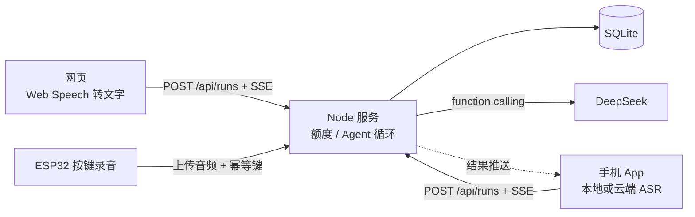
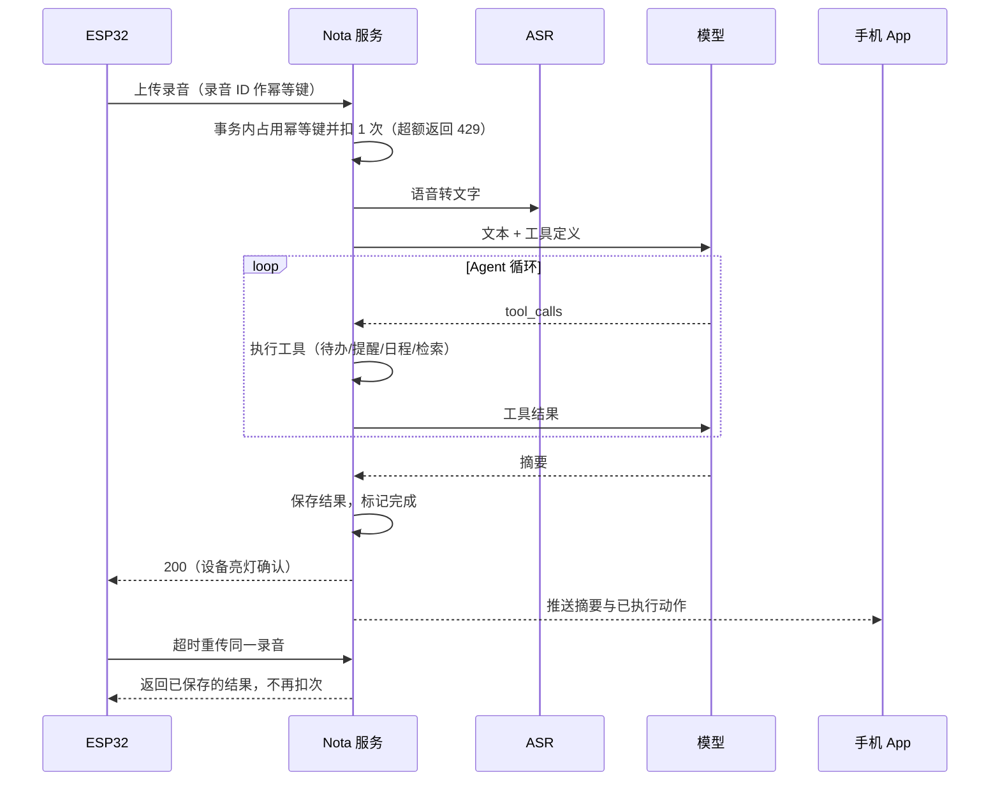

# Nota · AI 语音便签

说一段话或输入文字，AI Agent 自己决定调用哪些工具：建待办、设提醒、建日程（可下载 .ics）、检索历史；界面实时显示每一步工具调用和结果。也可以对历史记录提问。

## 运行

需要 Node.js 26（直接运行 TypeScript，使用内置 `node:sqlite`），运行时零依赖。

```bash
cp .env.example .env      # 填入 LLM_API_KEY
npm start                 # http://localhost:3000
```

| 命令 | 作用 |
| --- | --- |
| `npm test` | 全部验收测试（含压测），用本地假模型，无需 key |
| `npm run loadtest` | 只跑额度压测 |
| `npm run eval` | 用真实模型跑 19 条中文样例，输出通过率（低于 80% 退出码为 1） |
| `npm run check` | TypeScript 类型检查（需先 `npm install`） |
| `npm run plan -- <userId> pro` | 运维命令：切换用户计划 |

环境变量：`LLM_BASE_URL`（默认 `https://api.deepseek.com`）、`LLM_API_KEY`、`LLM_MODEL`（默认 `deepseek-flash`，即 DeepSeek-V4.1-Flash）、`PORT`、`DB_PATH`。

语音输入用浏览器 Web Speech API，仅 Chrome 可用；其他浏览器直接打字。提醒只在网页打开期间到点弹出通知，没有服务端推送。

## 架构与关键取舍

网页提交后，服务端用 SSE 推送 Agent 每一步。Agent 是手写的 OpenAI 兼容 function calling 循环（直接 fetch，无 SDK 和框架）；系统提示注入当前时间与用户时区，由模型换算“下周三”，工具拒收不带偏移的时间并把错误回给模型修正。

额度：幂等键占位和扣次在同一 SQLite 写事务内，靠唯一约束和条件 upsert（`used < 10`）完成，不先读后写；按用户时区的自然日计次。模型失败则退还额度并撤销本次动作。提问同样扣 1 次。

历史检索：FTS5 trigram 搜不了两字中文词，改由模型给出空格分隔的关键词，在该用户数据上做子串匹配，适合个人数据量。

用户身份是浏览器生成的 ID，仅供演示。

## 额度规则

- 每次 AI 处理（记录或提问）扣 1 次；Free 每自然日 10 次，自然日按用户首次访问时上报的时区计算，之后不可更改（防止改时区刷额度）；Pro 不限。
- 每次提交带幂等键：同一键处理中再次提交返回 409，完成后再次提交原样返回首次结果，不再扣次；网页在网络中断后重试会复用同一键。
- 模型调用失败：本次退还额度，撤销本次已执行的动作，同一幂等键可重新提交。
- 服务进程在处理中途崩溃：处理中的请求持有 30 秒租约，由所在进程每 10 秒续期；租约过期后，该用户下次访问时这次请求按失败处理（退还额度、撤销动作），同一幂等键可重新提交。Agent 建待办、提醒、日程时与“仍持有租约”的校验在同一条 SQL 内完成，租约被回收或被接管后，旧执行者写不进任何动作，也改不了新结果。
- 旧版本建的数据库启动时自动加上租约字段；升级前停在“处理中”的请求视为已过期，首次访问时退款并撤销一次。

## 额度证明（压测）

`npm run loadtest` 启动**两个真实服务进程**共享同一个 SQLite 文件，模型侧换成本地假的 OpenAI 兼容服务（通过 `LLM_BASE_URL` 指过去），对 HTTP 接口并发请求，两个进程轮流接收。实测结果（2026-11-02，全部通过，退出码 0）：

| 场景 | 断言 | 结果 |
| --- | --- | --- |
| 同一 Free 用户 50 个并发不同请求 | 恰好 10 个成功、40 个 429，计数为 10，笔记 10 条 | 通过 |
| 同一幂等键 20 个并发重复提交，完成后再提交一次 | 只扣 1 次、只产生 1 条笔记和 1 条待办，所有成功响应是同一结果 | 通过 |
| 模型返回 500 | 计数回到 0，Agent 已建的待办被撤销 | 通过 |
| Pro 用户 15 个并发 | 全部成功 | 通过 |
| 处理中服务被杀，重启后（租约已过期）查询并重试原幂等键 | 计数先回到 0，重试成功后为 1，只有 1 条笔记 | 通过 |
| 旧执行者的租约被另一进程接管，接管者用同一幂等键完成后旧执行者才拿到模型响应 | 旧执行者报错，计数 1、待办 1 条、笔记 1 条，重放结果是接管者的结果 | 通过 |
| 用旧版本表结构的数据库启动 | 已完成的结果可重放，遗留的处理中请求退款、其半截待办被撤销，重试成功 | 通过 |
| 跨日重置 | 上海时间 23:59 用满 10 次后被拒；00:01（UTC 仍是同一天）重启服务后可用，计数为 1 | 通过 |

跨日场景通过预加载脚本设定服务进程的时钟起点，业务代码没有测试专用开关。为确认测试能发现问题，临时把上限条件改成 11、把计日时区改成 UTC，对应用例都会失败。

## 效果评估

`eval/cases.json` 有 19 条中文样例，固定“现在”为 2026-11-02（周一）10:00 Asia/Shanghai。每条断言模型应调用的工具和关键参数：时间按用户时区精确到分钟（如“下周三下午三点”必须是 2026-11-11 15:00），文本用正则匹配；还断言不该调用的工具（纯日记不建待办、提问不创建东西）和回答内容（问历史要答出“15 万”）。覆盖相对时间、提前量、默认时刻、口语转写、多动作、引用历史、查无结果。

2026-11-02 使用 `deepseek-flash` 共跑 4 轮：第 1 轮 18/19，唯一失败是答案写成“15 万”带空格、样例正则写的是“15万”，答案本身正确，于是放宽了正则；之后 3 轮均为 19/19（最后一轮在系统提示加入“回复不用 Markdown”之后）。单条耗时约 1–4 秒。19 条样例对这个模型已接近饱和，区分度有限，后续应补更难的样例（跨月、模糊时间、多人多事）。

## 网页、App 与硬件（设计，未实现 App 和硬件）

三端共用同一套 HTTP 接口和额度：



一条硬件录音的时序。幂等键由设备给每段录音生成，弱网重传不会重复扣次：


