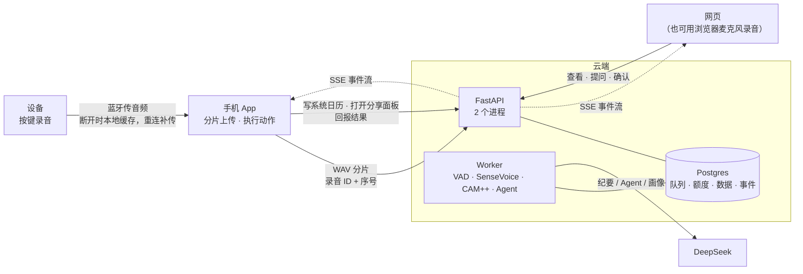
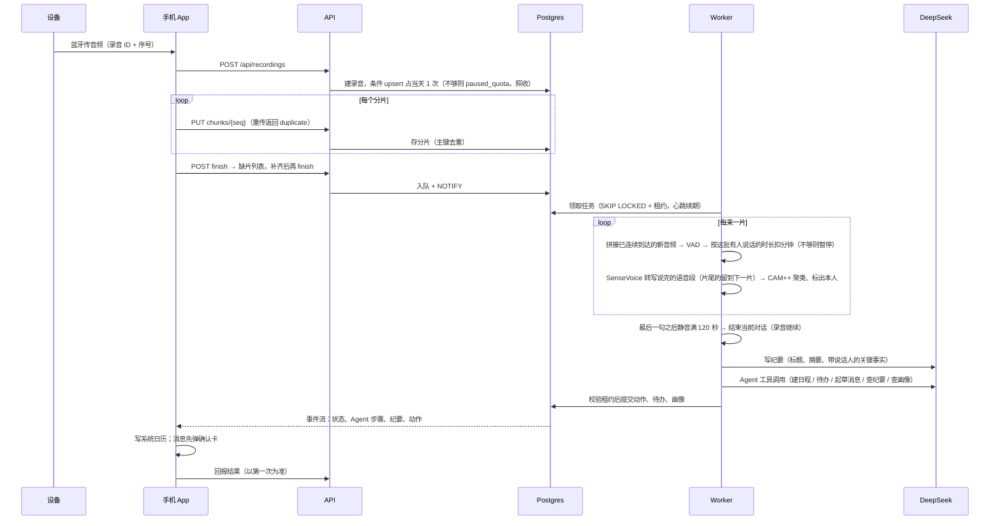

# Nota · AI 语音便签（v2）

录音设备经蓝牙交给手机，手机分片上传；云端切出对话、写纪要、认出用户本人，再由 Agent 决定要办的事，写日历、发消息这类动作交给手机执行。也可以直接输入文字，或对历史提问。

一句话：**Nota ≈ Omi 的录音与处理链路 + OpenMinis 式的手机端执行**。

本仓库包含后端（`backend/`）、网页（`web/`，由后端托管）、设备模拟器（`device-sim/`）和分环节评估（`eval/`）；Flutter App 在 `app/`。前后端唯一的共享边界是 [`docs/contract.md`](docs/contract.md)。

## 运行

需要 Docker、[uv](https://docs.astral.sh/uv/)、macOS（测试与评估用 `say` 合成语音）。转写和声纹模型在本地 CPU 上运行，首次启动会从 ModelScope 下载到 `~/.cache/modelscope`（约 1 GB）。

```bash
docker compose up -d                 # Postgres 18，端口 55432
cp .env.example .env                 # 填入 LLM_API_KEY（只放在 .env，不入库）
cd backend && uv sync && ./start.sh  # 1 个 Worker + 2 个 API 进程
open http://localhost:8077           # 网页：录音或输入文字、看纪要与动作、提问、编辑画像、注册声纹
```

| 命令（在仓库根目录） | 作用 |
| --- | --- |
| `cd backend && uv run pytest` | 23 条验收测试，含三本账并发压测（真实多进程服务 + 真实 Postgres，模型用本地假服务） |
| `uv run --project backend eval/run.py [--repeat 3]` | 分环节评估：转写、声纹、动作、纪要、问答 |
| `uv run device-sim/sim.py speech.wav --drop 1,3 --dup 3 --shuffle --restart 3` | 模拟设备断网补传、重复发片、乱序，打印“只处理一次、只扣一次”的证明 |
| `cd backend && uv run python -m nota.admin set-plan <用户ID> pro` | 运维命令：切换计划（网页上不能自己升级） |

语音模型 HF 下载慢时可设 `HF_HUB_DISABLE_XET=1` 或 `HF_ENDPOINT=https://hf-mirror.com`。

## 架构与关键取舍

一个 FastAPI 服务加一个 Postgres：任务队列（SKIP LOCKED + 租约）、三本额度账、事件推送（LISTEN/NOTIFY）都在同一个库里，靠事务保证一致，不引 Redis。分片一到就处理已连续到达的部分：Silero VAD 算有人说话的时长并按批计费，SenseVoice 转写，CAM++ 认出用户本人；碰到片尾的语音留到下一片。静音满 120 秒即结束当前对话，立刻写纪要、跑 Agent、学画像，录音继续。每步存检查点，所有写入都校验租约。Agent 手写工具循环，只决策：日历和消息交给手机执行，发给别人的要确认。

## 处理链路与额度

- **录音**：`POST /api/recordings` 占当天 1 次；分片按“录音 ID + 序号”幂等落库，重复的片返回 `duplicate: true`；`finish` 返回缺片。文字走 `/api/notes/text`，跳过转写。
- **边录边转写**：每个新分片都会唤醒该录音的任务（任务正在跑时，跑完再跑一次）。任务只处理从 0 号起连续到达、尚未转写的那段音频：VAD 后转写确定已说完的语音段，离已到音频末尾不足 0.8 秒的语音段留到下一片或 `finish` 再处理，所以分片边界不会切断一句话。最后一句话之后已确认有 120 秒静音时，当前对话结束并立刻出纪要、跑 Agent，后面的音频归入新对话；`finish` 收尾最后一段。转写进度（游标、已入对话的语句、说话人聚类）是检查点，和这一批的计费在同一个事务里提交。
- **三本账**（按用户首次访问时上报的时区计自然日、自然月，时区之后不可改）：
  - 今日录音：Free 每天 10 次，按下到停止算 1 次；
  - 语音分钟：Free 每月 300 分钟有效语音（去静音后，每转写一批扣一批）；Pro 不限，但有滚动公平使用上限：任意 24 小时 4 小时、3 天 16 小时、7 天 20 小时（参数同 Omi）；
  - 提问：Free 每月 30 次，与录音分开计。
- **原子性**：次数和月度分钟用一条条件 upsert（`used < limit`）检查并扣减，不先读后写；Pro 的滚动窗口是求和，在用户行锁下检查并扣减。当天次数每条录音只有一行（`recording_charges`）；分钟按批记在 `minute_charges`，与推进转写游标在同一事务提交，重投、重试、接管都不会重复扣。
- **额度用完只停 AI，不停录音**：录音和分片照收照存，状态为 `paused_quota`；Worker 每 30 秒（以及启动时、改计划时）重试，额度恢复后自动处理。
- **失败退还**：一个任务最多重试 3 次（指数退避加抖动），最终失败时退还当天次数和分钟；提问失败退还提问次数。处理中的进程崩溃时，租约过期后由其他 Worker 接管、从检查点继续，不重复扣费。
- **本人识别**：注册了声纹，与之相似度达到阈值的说话人标为“我”，Agent 只按“我”的意图办事；没注册时谁都不标，用第一人称提出的安排按用户本人的意图处理。
- **动作**：日程把提醒挂在日程上（`alarm_minutes_before`），不另建提醒；`share_message` 一律 `pending_confirmation`；手机回报以第一次为准；撤销会生成一条 `delete_calendar_event`。待办存在服务端。
- **画像与纪要**：画像每条不超过 200 字，新事实取代旧事实，超预算时要求模型压缩，用户可改可删，用户改过的条目不会被模型的并发改写覆盖；纪要按人名、日期、关键词查询，回答带出处（对话、开始时间、第几秒）。

## 借鉴来源

| 来源 | 借鉴了什么 | 没有照搬什么 |
| --- | --- | --- |
| [Omi](https://github.com/BasedHardware/omi)（MIT） | 设备 → 蓝牙 → 手机 → 云端的链路；分片补传、云端拼接后按静音切段、静音 120 秒判定对话结束；按有人说话的时长按月计费、Pro 的 4h/16h/20h 滚动公平使用上限、提问单独按月限、超额只停云端处理；检索架构里的不变量：身份由调用方给出不从文本推断、工具结果进模型前先截断、检索内容只当数据 | Firestore、Redis、GPU 服务和实时流式转写，换成一个服务加一个 Postgres、本地 CPU 模型 |
| 圆桌 AI 的记忆模块 | 画像的规则：固定类别、每条一件事且有长度上限、模型用短记号指代既有条目来取代或删除、新事实覆盖旧事实、超预算时要求压缩、用户可查看和修改且用户的修改优先 | 圆桌的类别（这里换成人物、背景、偏好、近期）；画像不负责查事，查事交给纪要 |
| [OpenMinis](https://github.com/OpenMinis/OpenMinis)（GPLv3，手机端 AI Agent） | “云端决策、手机执行系统日历”参考了它的手机端执行设计 | 未使用其代码（GPL） |

## 三端关系与一条录音的时序

与 Part A T1 一致：设备只开蓝牙，由手机中转上传；网页只看结果和操作，不执行系统动作。





## 额度压测结果

`cd backend && uv run pytest` 启动真实服务：uvicorn 2 个 API 进程、2 个 Worker 进程，共用 docker-compose 里的 Postgres 18（每个测试模块一个临时库），模型侧是本地假的 OpenAI 兼容服务（`LLM_BASE_URL` 指过去），语音用 `say` 合成后经真实的 VAD、SenseVoice、CAM++ 处理。为让几秒钟的语音就能用完分钟额度，压测模块把 Free 月分钟和 Pro 24 小时上限设为 0.15 分钟，其余为默认值。2026-11-03 实测 23 条全部通过（约 40 秒，退出码 0）：

| 场景 | 结果 |
| --- | --- |
| 同一 Free 用户 50 个并发开始录音 | 恰好 10 个 `ai=enabled`、40 个 `paused_quota`，50 个全部保存，今日次数为 10 |
| 同一录音 ID 并发开始 20 次；每个分片乱序重复发 4 次；处理完后再发 | 只占 1 次；每片只有 1 次 `duplicate:false`；分钟只扣 1 次；只产生 1 段对话 |
| 先发一半分片就结束 | 返回缺的序号，补齐后返回空 |
| 同一文字幂等键并发 20 次 | 同一条录音，只扣 1 次 |
| Free 分钟用完 | 后一条录音照收，状态 `paused_quota`，月用量不超过上限 |
| Pro | 三本账 `limit` 都为 `null`；超过 24 小时公平使用上限后暂停 |
| 提问并发 40 次（月限 30） | 恰好 30 次成功、10 次 429 `ask_quota`；同一键重放同一答案，只扣 1 次 |
| 文字和录音的模型调用失败、提问失败 | 重试用尽后状态 `failed`，今日次数、分钟、提问次数全部退回 0 |
| Worker 在整理中被 kill -9 | 新 Worker 在租约过期后接管、完成；只有 1 段对话，次数和分钟只扣 1 次 |
| 录音未结束：3 秒一片（切断句子）上传一句话加 125 秒静音，不调 finish | 静音满 120 秒后经事件流收到这段对话的纪要（句子完整）和 Agent 建的日程；之后的话归入第二段对话，finish 后共 2 段 |
| 上海时间 11 月 30 日 23:59 → 12 月 1 日 00:01（UTC 仍是 11 月 30 日）重启 | 当天第 11 条与超额的录音自动处理；今日次数归新的一天、为 1；月分钟归 `2026-12` |

另做了反向验证：把次数上限条件改成 `limit + 1`，或把计日时区改成 UTC，对应用例都会失败。

`device-sim` 对真实 DeepSeek 跑一段 16 秒的两人对话（3 秒一片、丢第 1、3 片、每片发 3 次、乱序、开始调用 3 次）：服务端报缺 `[1, 3]`，补传后为空；今日次数 0 → 1，语音分钟 0 → 0.22；生成 1 段对话；处理完再发第 0 片返回 `duplicate=True`。同样对真实 DeepSeek：上传一句话加 125 秒静音（10 秒一片）、不调 finish，4 秒后就经事件流收到这段对话的纪要和“提前 1 天提醒”的日程动作；之后的话进入第二段对话。

## 评估结果

`uv run --project backend eval/run.py --repeat 3`，2026-11-03，模型 `deepseek-flash`，退出码 0。固定“现在”为 2026-11-02（周一）10:00 Asia/Shanghai。

| 环节 | 方法 | 结果 |
| --- | --- | --- |
| 转写 | 10 句含人名和数字的中文，用 `say` 的 Tingting（普通话）、Meijia（台湾）、Sinji（粤语）各合成一遍；比对前把阿拉伯数字按读法转成汉字、去掉标点 | 错字率 Tingting 1.6%、Meijia 0.8%、Sinji 0.0%；人名和数字关键词 54/54 |
| 声纹 | 用 Tingting 朗读注册，Tingting 的 10 句为本人，另两个声音的 20 句为他人，阈值 0.75 | 本人被认成别人 0/10，别人被认成本人 0/20；本人得分 0.87–0.92，他人 0.19–0.61 |
| 动作 | 旧版 27 条中的 23 条移植到新工具集（提醒并入日程：`remind_at = start − alarm_minutes_before`），每条跑 3 次 | 67/69（97%）；另统计“同一件事既建日程又建待办”1 次 |
| 纪要 | 4 段带说话人的对话，检查关键数字是谁说的、有没有编造数字、闲聊不硬记 | 12/12 |
| 问答 | 旧版 4 条提问加 2 条新难例（“上个月跟李总谈的预算”、“18 万是谁提的”），检查答案和出处 | 17/18（94%） |

失败样例：
- **动作·多人多事（1/3 通过）**：“让小李周三前把设计稿发我”，模型 2 次没建待办，认为这是小李的事。样例期望用户本人建一条跟进待办，两种理解都说得通，保留为失败。
- **问答·查无结果（2/3 通过）**：有 1 次回答“没找到”，却给无关的跑鞋纪要标了出处。已在提示词里要求“与问题无关的结果不要提也不要标”，仍偶发。

局限：转写和声纹样例是合成语音，只有 3 个声音，远不能代表真实会议（口音、抢话、远场、多人）；声纹阈值要用真实录音重新定。

## 已知局限

- 不做实时字幕：转写按分片批量进行，一片约 10–60 秒。
- 音频分片存在 Postgres 的 `bytea` 里；正式部署应放对象存储。
- 确认卡片没有过期时间；人物别名（张总 = 张伟）只记在画像里，没有单独的人物表。
- 用户身份是客户端生成的 ID，没有鉴权，仅供演示。
- 网页的浏览器录音用 ScriptProcessor 采集；只在 Playwright 下用注入的音频流验证过，真实麦克风需手动试。

## SenseVoice 授权说明

SenseVoice-Small 在 ModelScope（`iic/SenseVoiceSmall`）标注为 Apache-2.0；Hugging Face 上的同名模型指向 FunASR 的模型协议，要求使用时注明出处。两处说法不一致，商用前需向 FunASR 团队核实。CAM++（`iic/speech_campplus_sv_zh-cn_16k-common`）与 Silero VAD（MIT）同样在部署前核对各自协议。
